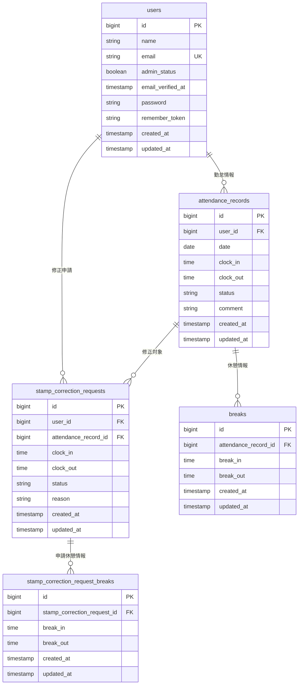

## 勤怠管理アプリ

## 概要

このアプリは出勤退勤の管理が目的です

## 環境構築手順

- Dockerのビルドからマイグレーション、シーディングまでを記述する

## 使用技術(実行環境)

- Laravel 10.x
- PHP
- Mysql
- Docker
- Laravel Sail

## 実装・設定上の注意事項

提供されたBladeファイルの修正

提供されたBladeファイルを使用し、バックエンド処理と連携するために必要な修正を行っています。

主な修正内容は以下のとおりです。

- Controllerから渡される変数名と、Bladeで使用する変数名の統一
- Controllerが受け取るURLパラメータ名と、Bladeのリンクで使用するパラメータ名の統一

デザインやレイアウトの枠組みは維持し、勤怠管理機能を動作させるための修正を行っています。
本リポジトリのコードを使用して環境構築する際は、GitHubに登録されている修正後のBladeファイルを使用してください。

## ER図

< - - - 作成したER図の画像 - - - >



※ attendance_recordsテーブルでは、user_idとdateの組み合わせに
UNIQUE制約を設定しています。

## URL

- 開発環境 : http://localhost/

```

```
